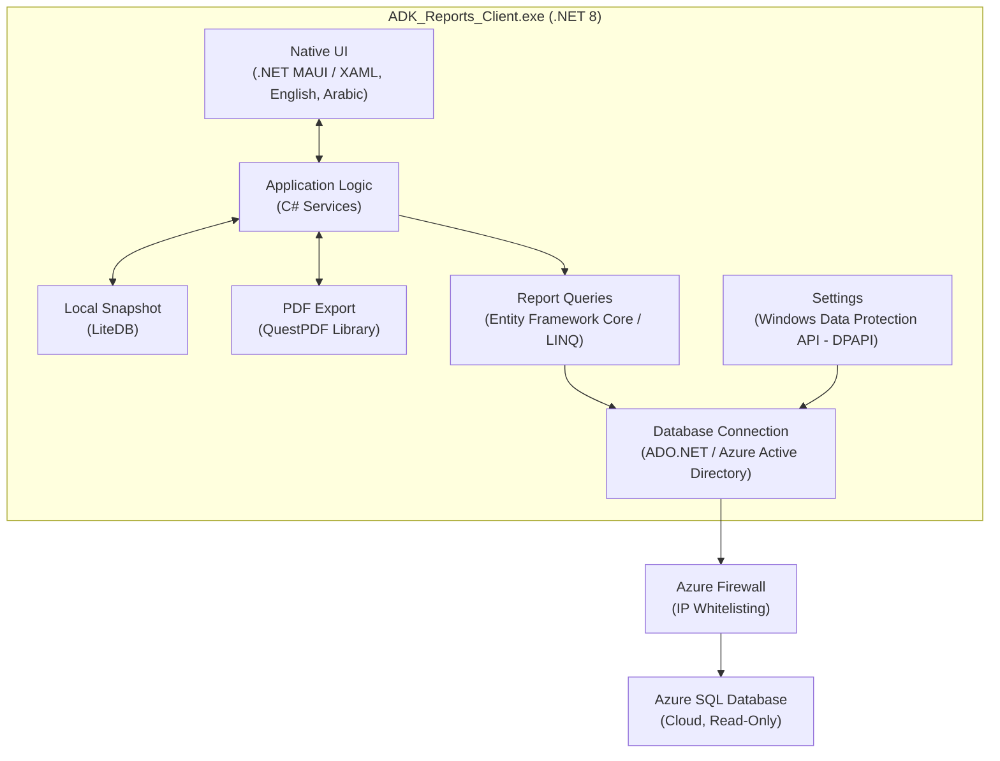

# (.NET MAUI & C#)

This alternative moves away from the concept of a "locally hosted web application" and focuses on building a native desktop application using Microsoft technologies. It delivers very high performance on Windows operating systems.

## Architecture Diagram

## Technologies Overview

1. **User Interface (.NET MAUI):** Instead of relying on a web browser, the application uses a native user interface that delivers a faster user experience and seamless integration with the operating system.
2. **Application Logic (C# Services):** There is no need for an internal web server. All application logic runs directly within the application using C#.
3. **Local Database (LiteDB):** A high-performance NoSQL database written in C#. It is a lightweight alternative to SQLite, particularly suitable for .NET environments.
4. **PDF Export (QuestPDF):** A powerful C# library for programmatically generating PDF files with excellent performance, without requiring a headless browser.
5. **Database Connectivity (Azure SQL):** The application connects directly to the cloud-hosted Azure SQL Database using ADO.NET over encrypted connections. This eliminates the need for an SSH tunnel by relying on Azure Firewall rules and secure authentication mechanisms.